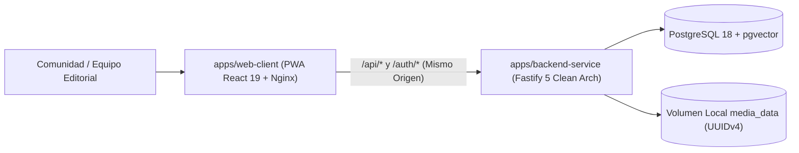

# Documento Maestro de Arquitectura y Dominio — Diccionario Misak

**Proyecto**: `Wamtɵrmarɵpik — Diccionario Misak`  
**Última Actualización**: 2026-11-08  
**Versión Vigente**: `v0.5.0-alpha.0`

---

## 1. Propósito y Visión Institucional

El **Diccionario Misak** (`Wamtɵrmarɵpik`) es una plataforma digital bilingüe (**Namtrik – Castellano**) dedicada a preservar, estructurar y difundir el conocimiento lingüístico y territorial del pueblo Misak (Cabildo Indígena del Resguardo de Guambia, Cauca, Colombia).

A diferencia de un glosario alfabético convencional, el sistema organiza el léxico a partir de la **cosmovisión territorial y semántica Misak**, articulando:

- **Exploración pública inmersiva y offline-first (PWA)** adaptada a dispositivos móviles y condiciones de conectividad variable en el territorio.
- **Fidelidad ortográfica y fonética** para los grafemas propios del Namtrik (como `ɵ` `U+0275`), variantes léxicas, diálogos contextuales y pronunciaciones grabadas por hablantes nativos.
- **Gobierno editorial autónomo** con control de acceso basado en roles (RBAC), flujo de ratificación cultural y trazabilidad inmutable de cada cambio.

---

## 2. Arquitectura General del Sistema

El repositorio opera como un **monorepo `pnpm`** compuesto por dos aplicaciones desacopladas (`apps/web-client` y `apps/backend-service`), fuentes declarativas de datos (`data/`) y especificaciones ejecutables (`specs/`).

### Fronteras Arquitectónicas

1. **Separación estricta de responsabilidades**: `web-client` consume únicamente contratos HTTP JSON/binarios y nunca accede a PostgreSQL; `backend-service` expone lógica de dominio, seguridad y streaming sin acoplarse al renderizado UI.
2. **Clean Architecture en el servidor**: Las reglas de negocio residen en `src/domain/` y `src/application/`, independientes de Fastify (`src/presentation/`, `src/api/`) y de Prisma/almacenamiento (`src/infrastructure/`).
3. **Aislamiento de carga pública vs. administrativa**: Todo el código de `/admin/*` se compila en un chunk independiente (`admin`) excluido del precache del Service Worker público.

---

## 3. Dominio Lingüístico y Modelo de Datos

### 3.1 Taxonomía Semántica Recursiva (`v1`)

Definida declarativamente en `data/taxonomy/v1/taxonomia.yaml` y `data/taxonomy/v1/home-slots.yaml` e importada de forma idempotente (`taxonomy:import`), consta de **65 nodos** organizados en tres niveles jerárquicos más **7 `HomeSlot`** de portada (`4` activos vinculados a `C1..C4` y `3` espacios proyectados: *Namui Nu Pirɵ*, *Namui Nu Isuik*, *Srɵ Wammera*):

1. **Campos Semánticos (`CampoSemantico` — 4 raíces ratificadas)**:
   - `C1` — **Ya** (*La casa*)
   - `C2` — **Ya tul** (*La huerta*)
   - `C3` — **Tra tul** (*La huerta lejana*)
   - `C4` — **Kau ushamera** (*Los animales originarios*)
2. **Subcampos Semánticos (`SubcampoSemantico` — 18 nodos)**: Agrupaciones temáticas intermedias dentro de cada campo.
3. **Microcampos (`Microcampo` — 43 nodos: 34 de primer nivel + 9 subniveles recursivos)**: Categorías específicas con soporte de recursividad (`padreId`, `profundidad`) para modelar sub-agrupaciones culturales sin límite artificial de niveles.

### 3.2 Modelo Léxico Canónico: `Sentido + Formas` (`ADR-0003`)

El corpus activo (`data/lexicon/v1/`: **1.351 sentidos léxicos** y **1.451 formas Namtrik**) se modela separando el significado semántico de sus realizaciones formales:

- **`SentidoLexico`**: Representa una acepción o concepto cultural único con glosa en castellano, categoría gramatical, nombre científico opcional (`nombreCientifico`), oraciones de ejemplo, par dialógico (`pregunta`/`respuesta`), estado editorial (`estado`: `"borrador"` | `"ratificado"`, `ratificadoPorId`, `ratificadoEn`) y soporte de papelera (`deletedAt`).
- **`FormaNamtrik`**: Modela las realizaciones formales y variantes ortográficas o dialectales asociadas a un sentido (`V. 1..3`), ordenadas explícitamente (`orden`, donde `orden = 1` representa el lema o forma principal) sin duplicar la definición semántica.
- **`SentidoUbicacion`**: Relación muchos-a-muchos polimórfica que vincula cada sentido a uno o varios nodos taxonómicos (campo, subcampo o microcampo).
- **`EquivalenciaBilingue` (`Spec 012`, migración `0014`)**: Matriz relacional determinista (`1.633` equivalencias indexadas: `glosa_directa`, `sub_acepcion`, `nucleo_nominal`, `raiz_morfologica`) que conecta sub-acepciones y familias léxicas entre Namtrik y Castellano.
- **`AbreviaturaGramatical` (`Spec 012`, migración `0015`)**: Catálogo dinámico gobernado de `41` abreviaturas lingüísticas oficiales (`data/lexicon/v1/abreviaturas.yaml`) con protección `HTTP 409 Conflict` ante eliminación de abreviaturas en uso.

> **Gestión de Esquema Heredado (`ADR-0007`, Estrategia Opción B)**: Las tablas iniciales `PalabraModelo1`, `PalabraModelo2`, `PalabraM1Microcampo`, `PalabraM2Microcampo` y `PasswordReset` permanecen declaradas sin filas activas en `prisma/schema.prisma` exclusivamente para garantizar la reproducibilidad lineal del historial de migraciones `0001`–`0015` hasta su retiro físico mediante migración dedicada.

### 3.3 Búsqueda Híbrida Multinivel Semaforizada con Ranking Cultural y Deep Linking (`Spec 009`, `Spec 012`, `ADR-0008`)

El endpoint `GET /api/dictionary/words/search` indexa desde `>= 1` carácter tanto los **nodos taxonómicos** (`Campo`, `Subcampo`, `Microcampo` y `Subnivel` recursivo) como los **sentidos léxicos** (`FormaNamtrik`, `espanolGlosa`, `EquivalenciaBilingue`, `nombreCientifico`, contexto y explicación), combinando normalización fonética armónica (`public.immutable_normalize_namtrik_es`), similitud por trigramas (`pg_trgm`), FTS, puerto vectorial `ISemanticEmbeddingProvider` (`pgvector` HNSW bajo principios CARE) y **Reciprocal Rank Fusion (`RRF`, $k = 60$)**. En el cliente, el buscador global `<dialog>` (`Ctrl+K` / `⌘K` / `/` y `DraggableSearchTrigger` con persistencia `FabAnchor`) presenta insignias semaforizadas por nivel jerárquico (`1..5`) y navega mediante anclajes deterministas (`#term-{id}` y `#subnivel-{slug}`) estabilizados sin CLS (`useDeepLinkAnchor`).

---

## 4. Sistema Multimedia Escalonado (`ADR-0005`)

Los recursos audiovisuales (`MedioCultural`) enriquecen cada sentido léxico con grabaciones de pronunciación y fotografía/ilustración cultural bajo cuatro garantías técnicas:

1. **Validación Binaria Estricta (`MagicByteValidator`)**: Inspección de cabeceras binarias reales (*magic bytes*) en servidor antes de persistir cualquier archivo cargado vía `@fastify/multipart` (límite de `100 MB`), rechazando extensiones o tipos MIME falsificados.
2. **Almacenamiento Local Opaco**: Escritura fuera del árbol web público en subdirectorios particionados por `UUIDv4` (`uploads/media/`), respaldados en Docker por el volumen persistente `media_data`.
3. **Streaming HTTP 206**: El endpoint `GET /api/media/:uuid/stream` sirve rangos de bytes parciales (`206 Partial Content`), permitiendo reproducción inmediata y búsqueda temporal en audios extensos sin *buffering* en Nginx.
4. **Experiencia Accesible y Offline**: En el cliente, `AudioPlayerContext` garantiza reproducción *single-instance* (al iniciar un audio se detiene cualquier otro activo), `CulturalImageLightbox` implementa diálogo modal accesible WAI-ARIA, y Workbox almacena en caché local hasta 150 medios consultados (`misak-cultural-media-cache`).

---

## 5. Seguridad, Sesiones y Gobierno Editorial (`ADR-0004`)

### 5.1 Autenticación Híbrida Endurecida

- **Contraseñas**: Hashing primario con **Argon2id** (`@node-rs/argon2`, `64 MiB`, `timeCost: 3`, `parallelism: 4`); verificación heredada `bcryptjs` limitada a migración transparente en el login.
- **Ciclo de Sesión**: `accessToken` JWT HS256 (`15m`) almacenado únicamente en memoria (`Zustand`) para mitigar exfiltración por XSS, acompañado de un `refreshToken` opaco (`7d`) en cookie `HttpOnly` con rotación atómica en base de datos (`Session`) y coordinación *single-flight* en el cliente ante recargas (`F5`) o ráfagas concurrentes.
- **Defensa Activa**: Rate limiting estricto por `IP + usuario` en `/auth/login`, bloqueo temporal automático tras intentos fallidos, cambio obligatorio de clave temporal (`mustChangePassword`) y cabeceras `Cache-Control: no-store` en todas las rutas `/auth/*` y `/api/admin/*`.

### 5.2 Control de Acceso (RBAC) y Auditoría

El sistema implementa **6 roles institucionales** (`super_admin`, `admin`, `cultural_reviewer`, `content_admin`, `media_admin`, `analytics_viewer`) evaluados en cada endpoint protegido mediante `requirePermission()` y `requireSuperAdmin`. Toda mutación administrativa o editorial registra un evento inmutable en `AuditLog` con actor, IP, *user-agent*, estado previo (`oldData`) y estado nuevo (`newData`).

---

## 6. Sistema de Diseño e Identidad Visual Misak

### 6.1 Paleta Cromática Oficial

Basada en los cuatro colores sagrados de la bandera y el tejido tradicional Misak (`apps/web-client/src/index.css`):

- **Magenta Misak (`#e52d6d`)**: Acción primaria y énfasis cultural.
- **Azul Misak (`#0055aa`)**: Acción secundaria, anillos de enfoque y navegación.
- **Blanco Puro (`#ffffff`)**: Contraste tipográfico principal sobre fondos oscuros.
- **Negro Puro (`#000000`)**: Lienzo territorial base de la experiencia pública (con superficies `#141820` y `#07090d`).

En el panel administrativo (`.misak-admin-scope`), el sistema provee temas **Claro**, **Oscuro** y **Sistema** calibrados según **WCAG 2.2 AA**.

### 6.2 Armonización Tipográfica Compuesta (`ADR-0006`)

Para evitar discrepancias visuales al renderizar la vocal central Namtrik `ɵ` (`U+0275`) en títulos compuestos con `Spline Sans`, el cliente declara un `@font-face` compuesto para `'Spline Sans'` acotado a `unicode-range: U+019F, U+0259, U+0268, U+0275, U+028A` con `size-adjust: 96%` respaldado por `Noto Sans`, asegurando uniformidad geométrica en cualquier navegador o plataforma.

---

## 7. Decisiones Arquitectónicas Registradas (`specs/adr/`)

| ADR | Título y Decisión Clave |
| --- | --- |
| [ADR-0001](../specs/adr/0001-adopt-spec-driven-development.md) | Adopción de Spec-Driven Development (EARS + Gherkin + trazabilidad por commits) |
| [ADR-0002](../specs/adr/0002-multi-agent-tooling-antigravity.md) | Arquitectura multi-agente unificada en `.opencode/` con sincronización automática hacia `.agents/` |
| [ADR-0003](../specs/adr/0003-sentido-formas-y-ubicacion-multinivel.md) | Modelo de dominio canónico `SentidoLexico` + `FormaNamtrik` y ubicación taxonómica multinivel |
| [ADR-0004](../specs/adr/0004-sesion-admin-y-gobierno-editorial.md) | Sesión administrativa híbrida (JWT en memoria + cookie `HttpOnly`) y flujo de gobierno editorial |
| [ADR-0005](../specs/adr/0005-medios-culturales-storage-y-streaming.md) | Almacenamiento local seguro de medios culturales, validación magic bytes y streaming HTTP 206 |
| [ADR-0006](../specs/adr/0006-tipografia-compuesta-armonizacion-grafema-namtrik.md) | Armonización tipográfica mediante `@font-face` compuesto para el grafema Namtrik `ɵ` (`U+0275`) |
| [ADR-0007](../specs/adr/0007-saneamiento-deuda-tecnica-y-documentacion-canonica.md) | Saneamiento integral de deuda técnica, Estrategia Opción B de esquema y alineación documental/Docker |
| [ADR-0008](../specs/adr/0008-matriz-equivalencias-y-busqueda-hibrida-pgvector-rrf.md) | Matriz relacional de equivalencias bilingües, búsqueda híbrida multinivel RRF (`pgvector`), deep linking anti-CLS y catálogo dinámico de abreviaturas |
