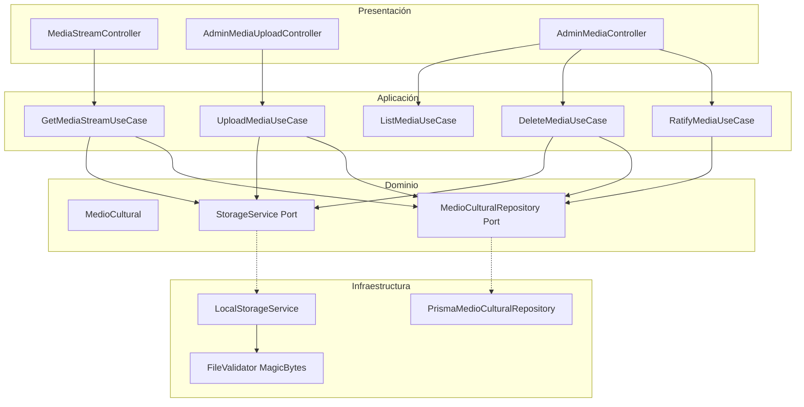

# Plan Técnico: 007 — Medios Escalonados

- **Feature**: `007-medios-escalonados`
- **Estado**: Planificado
- **Fecha**: 2026-10-17
- **Spec**: [`specs/features/007-medios-escalonados/spec.md`](file:///home/tumidev/developments/misak-dictionary/specs/features/007-medios-escalonados/spec.md)
- **ADR Asociado**: [`specs/adr/0005-medios-culturales-storage-y-streaming.md`](file:///home/tumidev/developments/misak-dictionary/specs/adr/0005-medios-culturales-storage-y-streaming.md)

---

## Diseño

El sistema de medios escalonados introduce capacidades de almacenamiento seguro, streaming HTTP Range 206, gobernanza editorial y reproducción/visualización accesible de grabaciones de audio e ilustraciones culturales.

### Arquitectura Backend (Clean Architecture)



1. **Capa de Dominio**:
   - Entidad `MedioCultural` con validaciones de tipos, estados y cálculos de metadatos.
   - Puertos `MedioCulturalRepository` y `StorageService`.
2. **Capa de Aplicación**:
   - `UploadMediaUseCase`: procesa el flujo multipart, ejecuta validación de magic bytes, genera UUID, almacena el archivo en disco, calcula hash SHA-256 y persiste la entidad en estado `borrador`.
   - `GetMediaStreamUseCase`: resuelve el medio por UUID, verifica el permiso o la condición `PUBLIC_ONLY_RATIFIED`, parsea cabeceras `Range` y retorna el stream binario con metadatos.
   - `RatifyMediaUseCase`: cambia el estado de `borrador` a `ratificado`, asigna el revisor cultural y emite evento de auditoría `MEDIA_RATIFY`.
   - `DeleteMediaUseCase`: efectúa soft-delete del registro en base de datos y opcionalmente marca el archivo para purga.
   - `ListMediaUseCase`: consulta paginada de medios con filtros por tipo, estado, sentido y forma.
3. **Capa de Infraestructura**:
   - Migración Prisma `0010_medios_culturales` para la tabla `medios_culturales`.
   - `LocalStorageService`: gestor de archivos en `/uploads/media/{audios,imagenes}` con nombres `{uuid}.{ext}`.
   - `MagicByteValidator`: inspección del encabezado binario para verificar mimetypes reales antes de procesar el archivo completo.
   - Registro de permisos `media:read`, `media:write`, `media:delete` en el seed y catálogo de RBAC.
4. **Capa de Presentación**:
   - Fastify routes para streaming público (`GET /api/media/:uuid/stream`) con soporte HTTP 206 y descarga de metadatos (`GET /api/media/:uuid/meta`).
   - Rutas administrativas protegidas bajo `/api/admin/medios` (`POST /upload`, `GET /`, `POST /:id/ratificar`, `PATCH /:id/metadatos`, `DELETE /:id`).

### Arquitectura Frontend

```mermaid
flowchart LR
    subgraph State
        AudioContext[AudioPlayerContext Single-Instance]
    end

    subgraph UI Pública
        AudioBtn[AudioPlayButton TapTarget 48px]
        LazyImg[LazyImage C3.3]
        Lightbox[CulturalMediaLightbox Modal A11y]
        TermRow[TermRow Integrado]
    end

    subgraph Admin
        AdminMediaPage[/admin/medios Gestión]
        MediaTab[/admin/sentidos/:id/editar Pestaña Medios]
        UploadModal[UploadMediaModal]
    end

    subgraph PWA
        SW[Workbox CacheFirst 100 Audios / 50 Imgs]
    end

    TermRow --> AudioBtn
    TermRow --> LazyImg
    LazyImg --> Lightbox
    AudioBtn --> AudioContext
    AudioContext --> SW
    AdminMediaPage --> UploadModal
    MediaTab --> UploadModal
```

1. **Reproductor Single-Instance (`AudioPlayerContext`)**:
   - Control centralizado con una sola instancia nativa de `Audio`.
   - Al invocar `play(uuid)`, detiene cualquier reproducción previa, resetea el tiempo y transiciona los estados (`loading`, `playing`, `paused`, `error`).
2. **Componente `AudioPlayButton`**:
   - Tap target mínimo $\ge 48 \times 48$ px.
   - Atributos accesibles `aria-label="Reproducir pronunciación en Namtrik de {lema}"`, `aria-pressed`, `aria-live`.
   - Estados visuales interactivos y manejo de errores con fallback visual no intrusivo.
3. **Visor de Medios Culturales (`CulturalMediaLightbox`)**:
   - Renderizado inicial obligatorio con `LazyImage` (Constitución C3.3).
   - Diálogo modal con `role="dialog"`, `aria-modal="true"`, `aria-label="Ilustración cultural: {glosa}"`.
   - Trampa de foco (*focus trap*), cierre con tecla `Escape` o clic fuera, devolviendo el foco al botón disparador.
   - Exhibición de créditos del hablante/fotógrafo, variante y licencia comunitaria Misak.
4. **Offline Caching en PWA**:
   - Configuración en `apps/web-client/vite.config.ts` de runtime caching de Workbox con `CacheFirst` para peticiones `/api/media/.*/stream`.
   - Cuotas: 100 archivos de audio y 50 imágenes con TTL de 30 días.
5. **Panel Administrativo**:
   - Página `/admin/medios` con tabla de búsqueda, previsualización de audio/imagen, subida de archivos y ratificación.
   - Pestaña de medios en el formulario de edición de sentidos (`/admin/sentidos/:id/editar`).

---

## Cambios por archivo

| Archivo | Cambio | Requisito |
| :--- | :--- | :--- |
| `apps/backend-service/prisma/schema.prisma` | Agregar modelo `MedioCultural` con relaciones hacia `SentidoLexico`, `FormaNamtrik` y `User` | R-001 |
| `apps/backend-service/prisma/migrations/0010_medios_culturales/migration.sql` | Migración SQL para la tabla `medios_culturales` con restricciones, checks e índices | R-001, R-002 |
| `apps/backend-service/src/shared/auth/permissions.ts` | Agregar permisos `media:read`, `media:write`, `media:delete` y asignarlos al rol `media_admin` | R-007 |
| `apps/backend-service/src/shared/storage/storage.service.ts` | Interfaz de puerto `StorageService` para persistencia y streaming de archivos | R-004 |
| `apps/backend-service/src/shared/storage/local-storage.service.ts` | Implementación en disco local (`uploads/media/`) con UUIDs opacos y gestión de streams | R-004, R-006 |
| `apps/backend-service/src/shared/validation/magic-byte-validator.ts` | Validador binario de cabeceras para audios (mp3, ogg, wav, webm) e imágenes (webp, jpeg, png, svg) | R-005 |
| `apps/backend-service/src/domain/entities/medio-cultural.entity.ts` | Entidad de dominio `MedioCultural` con reglas de estado y metadatos | R-001, R-002, R-003 |
| `apps/backend-service/src/domain/ports/medio-cultural.repository.ts` | Interfaz de repositorio para persistencia y consulta de medios | R-001, R-002, R-003 |
| `apps/backend-service/src/infrastructure/repositories/prisma-medio-cultural.repository.ts` | Implementación Prisma de `MedioCulturalRepository` | R-001, R-002, R-003 |
| `apps/backend-service/src/application/use-cases/media/upload-media.use-case.ts` | Caso de uso de carga de medios con validación binaria, guardado y estado `borrador` | R-001, R-004, R-005, R-008 |
| `apps/backend-service/src/application/use-cases/media/get-media-stream.use-case.ts` | Caso de uso de streaming HTTP Range 206 y cumplimiento de `PUBLIC_ONLY_RATIFIED` | R-002, R-004, R-006 |
| `apps/backend-service/src/application/use-cases/media/ratify-media.use-case.ts` | Caso de uso para ratificar medios culturales y registrar auditoría inmutable | R-003 |
| `apps/backend-service/src/application/use-cases/media/delete-media.use-case.ts` | Caso de uso para eliminación lógica y remoción de archivos | R-007, R-008 |
| `apps/backend-service/src/application/use-cases/media/list-media.use-case.ts` | Caso de uso de listado paginado con filtros administrativos | R-007, R-014 |
| `apps/backend-service/src/presentation/routes/media.routes.ts` | Rutas públicas `/api/media/:uuid/stream` y `/api/media/:uuid/meta` | R-002, R-006 |
| `apps/backend-service/src/presentation/routes/admin-media.routes.ts` | Rutas administrativas `/api/admin/medios` (upload, ratify, delete, update, list) | R-007, R-008, R-014 |
| `apps/web-client/src/shared/context/AudioPlayerContext.tsx` | Contexto y hook `useAudioPlayer()` con singleton nativo de audio y single-instance | R-009, R-010, R-013 |
| `apps/web-client/src/shared/components/AudioPlayButton.tsx` | Botón accesible de reproducción de audio con tap target $\ge 48$ px y estados | R-009, R-010 |
| `apps/web-client/src/shared/components/CulturalMediaLightbox.tsx` | Visor modal accesible (`role="dialog"`, focus trap, escape key, créditos culturales) | R-011 |
| `apps/web-client/src/features/dictionary/components/TermRow.tsx` | Integración de `AudioPlayButton` y miniatura con `LazyImage` + lightbox | R-009, R-011 |
| `apps/web-client/src/features/admin/pages/AdminMediaPage.tsx` | Página de administración general de medios multimedia en el panel administrativo | R-014 |
| `apps/web-client/src/features/admin/components/AdminMediaUploadModal.tsx` | Modal de carga y asignación de medios a sentidos o formas | R-014 |
| `apps/web-client/src/features/admin/pages/AdminSentidoEditPage.tsx` | Pestaña de gestión de medios vinculados en el formulario de edición léxica | R-014 |
| `apps/web-client/vite.config.ts` | Configuración de runtime caching en Workbox PWA (`CacheFirst` para audios e imágenes) | R-012 |
| `scripts/check-bundle-size.mjs` | Verificación de que el bundle no crezca $> +5\%$ vs línea base de 38.9 kB | R-013 |

---

## Contratos de UI/API

### 1. Esquemas Zod y DTOs de Backend

```typescript
// Subida de medios (multipart fields adicionales)
export const UploadMediaMetadataSchema = z.object({
  sentidoId: z.coerce.number().optional(),
  formaId: z.coerce.number().optional(),
  tipo: z.enum(['audio', 'imagen']),
  proposito: z.enum([
    'pronunciacion_lema',
    'contexto_oracion',
    'pregunta_dialogo',
    'respuesta_dialogo',
    'ilustracion_cultural',
    'fotografia_territorio',
  ]),
  hablanteAutor: z.string().max(255).optional(),
  varianteDialectal: z.string().max(100).optional(),
  descripcionEspanol: z.string().max(1000).optional(),
  descripcionNamtrik: z.string().max(1000).optional(),
  licenciaComunitaria: z.string().max(255).default('Propiedad Intelectual Colectiva del Pueblo Misak'),
});

export type UploadMediaMetadataDTO = z.infer<typeof UploadMediaMetadataSchema>;

// Actualización de metadatos culturales
export const UpdateMediaMetadataSchema = z.object({
  hablanteAutor: z.string().max(255).optional(),
  varianteDialectal: z.string().max(100).optional(),
  descripcionEspanol: z.string().max(1000).optional(),
  descripcionNamtrik: z.string().max(1000).optional(),
  licenciaComunitaria: z.string().max(255).optional(),
  sentidoId: z.number().nullable().optional(),
  formaId: z.number().nullable().optional(),
});

// Shape de respuesta pública de medio
export interface PublicMediaDTO {
  uuid: string;
  tipo: 'audio' | 'imagen';
  proposito: string;
  mimetype: string;
  duracionSegundos?: number | null;
  anchoPx?: number | null;
  altoPx?: number | null;
  hablanteAutor?: string | null;
  varianteDialectal?: string | null;
  descripcionEspanol?: string | null;
  descripcionNamtrik?: string | null;
  licenciaComunitaria: string;
  streamUrl: string;
}
```

### 2. Contratos de Rutas HTTP

- `GET /api/media/:uuid/stream`
  - **Cabeceras de entrada opcionales**: `Range: bytes=0-1024`
  - **Respuesta 206 Partial Content**:
    - `Content-Range: bytes 0-1024/204800`
    - `Accept-Ranges: bytes`
    - `Content-Length: 1025`
    - `Content-Type: audio/mpeg`
  - **Respuesta 200 OK** (si no hay Range):
    - `Content-Length: 204800`
    - `Content-Type: audio/mpeg`
- `POST /api/admin/medios/upload`
  - **Headers**: `Authorization: Bearer <token>`, `Content-Type: multipart/form-data`
  - **Permiso requerido**: `media:write`
  - **Respuesta 201 Created**: `{ success: true, data: { id, uuid, filename, estado: 'borrador', ... } }`
  - **Errores**: `400 Bad Request` (archivo excede tamaño o magic bytes inválidos), `403 Forbidden` (sin permiso).
- `POST /api/admin/medios/:id/ratificar`
  - **Headers**: `Authorization: Bearer <token>`
  - **Permiso requerido**: `taxonomy:ratify`
  - **Respuesta 200 OK**: `{ success: true, data: { id, estado: 'ratificado', ratificadoAt: '...' } }`

### 3. Contratos de Componentes Frontend

```typescript
// AudioPlayButton.tsx
export interface AudioPlayButtonProps {
  mediaUuid: string;
  namtrikLabel: string;
  espanolLabel?: string;
  size?: 'sm' | 'md' | 'lg';
  className?: string;
}

// CulturalMediaLightbox.tsx
export interface CulturalMediaLightboxProps {
  isOpen: boolean;
  onClose: () => void;
  mediaUuid: string;
  titulo: string;
  descripcionEspanol?: string;
  descripcionNamtrik?: string;
  autor?: string;
  licencia?: string;
}

// AudioPlayerContext.tsx
export interface AudioPlayerContextType {
  currentUuid: string | null;
  isPlaying: boolean;
  isLoading: boolean;
  error: string | null;
  play: (uuid: string) => Promise<void>;
  pause: () => void;
  stop: () => void;
}
```

---

## Decisiones tomadas

1. **ADR-0005**: Almacenamiento desacoplado con `StorageService`, nombres en disco opacos UUIDv4 y validación de Magic Bytes para prevenir path traversal y ejecución de malware.
2. **Streaming nativo con HTTP Range 206**: Respaldado por `fs.createReadStream` en Node/Fastify para garantizar scrubbing instantáneo y consumo óptimo de ancho de banda en redes móviles rurales.
3. **Singleton de Audio nativo en frontend**: Un único `HTMLAudioElement` orquestado mediante React Context, eliminando dependencias pesadas (Howler, Tone.js) para salvaguardar el umbral de tamaño de bundle R-023.
4. **Gobernanza cultural comunitaria**: Estado inicial `borrador` obligatorio; ningún medio se expone públicamente si no ha sido ratificado mediante el evento auditable `MEDIA_RATIFY` por un revisor cultural calificado.

---

## Riesgos y mitigación

| Riesgo | Probabilidad | Impacto | Mitigación |
| :--- | :--- | :--- | :--- |
| **Ataque de subida de archivos maliciosos (ejecutables camuflados)** | Media | Alto | Inspección de cabeceras binarias (Magic Bytes) estricta antes de escribir en disco permanente y renombramiento total a UUIDv4 sin extensiones ejecutables. |
| **Crecimiento excesivo del bundle principal de JavaScript (R-023)** | Media | Medio | Implementación del reproductor de audio usando la API nativa del navegador (`HTMLAudioElement`) y carga diferida (`React.lazy`) para el modal de lightbox y el panel de administración. |
| **Agotamiento de almacenamiento en disco local** | Baja | Alto | Límites estrictos de subida (Audio $\le 5$ MB; Imagen $\le 10$ MB), cuotas de PWA (100 audios / 50 imágenes) y arquitectura desacoplada para migrar a S3/Cloudinary sin rehacer controladores. |
| **Problemas de CORS o reproducción en Safari/iOS móvil** | Media | Medio | Soporte explícito de `Accept-Ranges: bytes` y respuestas `206 Partial Content` formateadas con precisión, indispensables para que WebKit/Safari reproduzca flujos de audio sin fallos. |
| **Difusión de material cultural no consentido** | Baja | Crítico | Validación del gate cultural (`cultural-gate: true`) e imposición técnica de `PUBLIC_ONLY_RATIFIED` en las consultas de streaming y metadatos públicos. |
