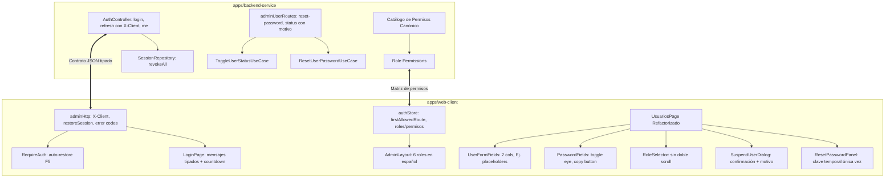

# Plan Técnico — Gobierno de Usuarios, Sesión y UX

**Feature:** `008-gobierno-usuarios-sesion`

## 1. Diseño de Arquitectura

## 2. Cambios por Archivo

| Archivo | Capa / Módulo | Propósito y Naturaleza del Cambio |
| :--- | :--- | :--- |
| `apps/backend-service/src/shared/auth/permissions.ts` | Backend Shared | Añadir permisos faltantes (`users:manage`, `settings:manage`, `dictionary:delete`, `taxonomy:revert`), matriz de 6 roles y metadatos legibles. |
| `apps/backend-service/src/domain/errors/AuthErrors.ts` | Backend Domain | [NEW] Errores tipados de dominio para mapeo HTTP preciso. |
| `apps/backend-service/src/presentation/controllers/AuthController.ts` | Backend Presentation | Formatear respuesta cookie-mode con usuario completo, mapear códigos de error semánticos. |
| `apps/backend-service/src/application/use-cases/admin/ToggleUserStatusUseCase.ts` | Backend Application | [NEW] Caso de uso para suspensión con revocación de sesiones, protección de auto-suspensión y auditoría con motivo. |
| `apps/backend-service/src/application/use-cases/admin/ResetUserPasswordUseCase.ts` | Backend Application | [NEW] Caso de uso para asignación de clave temporal y forzado de primer cambio. |
| `apps/backend-service/src/api/admin/routes/adminUserRoutes.ts` | Backend API | Exponer `POST /:id/reset-password`, actualizar `PATCH /:id/status` con motivo, migrar guardas a `users:manage`. |
| `apps/web-client/src/services/adminHttp.ts` | Frontend Services | Enviar `X-Client: web-admin` en refresh y logout, función `restoreSession()`, mapeo de errores `AdminApiError` con `code` y `retryAfterSeconds`. |
| `apps/web-client/src/components/admin/RequireAuth.tsx` | Frontend Components | Restaurar sesión en F5 usando `restoreSession()`, ruta accesible de cambio de clave. |
| `apps/web-client/src/stores/authStore.ts` | Frontend Stores | Función `firstAllowedRoute()`, supresión de atajo local super_admin. |
| `apps/web-client/src/router/index.tsx` | Frontend Router | Alinear permisos con el catálogo unificado, añadir ruta `/admin/cambiar-password`, redirección inteligente. |
| `apps/web-client/src/components/admin/AdminLayout.tsx` | Frontend Components | Alinear permisos de ítems de menú con el catálogo canónico. |
| `apps/web-client/src/pages/admin/LoginPage.tsx` | Frontend Pages | Mensajes amigables y cuenta regresiva de bloqueo temporal según código tipado. |
| `apps/web-client/src/pages/admin/usuarios/userCopy.ts` | Frontend Copy | [NEW] Glosario de textos sin tecnicismos para el módulo. |
| `apps/web-client/src/pages/admin/usuarios/roleCatalog.ts` | Frontend Roles | [NEW] Definición de los 6 roles en español, etiquetas de nivel y colores. |
| `apps/web-client/src/pages/admin/usuarios/UserFormFields.tsx` | Frontend UI | [NEW] Grilla unificada en 2 columnas con placeholders `Ej.`. |
| `apps/web-client/src/pages/admin/usuarios/PasswordFields.tsx` | Frontend UI | [NEW] Campos con botón de ojo (mostrar/ocultar) y copiado de clave. |
| `apps/web-client/src/pages/admin/usuarios/RoleSelector.tsx` | Frontend UI | [NEW] Selector de 6 roles en español sin scroll interno secundario. |
| `apps/web-client/src/pages/admin/usuarios/SuspendUserDialog.tsx` | Frontend UI | [NEW] Modal de confirmación con motivo opcional para suspender acceso. |
| `apps/web-client/src/pages/admin/usuarios/ResetPasswordPanel.tsx` | Frontend UI | [NEW] Panel de clave temporal con visualización única y copiado seguro. |
| `apps/web-client/src/pages/admin/UsuariosPage.tsx` | Frontend Pages | Orquestación limpia integrando subcomponentes y eliminando tecnicismos. |
| `apps/web-client/src/hooks/useAdmin.ts` | Frontend Hooks | Actualizar mutaciones y consultas con los nuevos endpoints y parámetros. |

## 3. Decisiones Técnicas Tomadas

1. **Catálogo Canónico:** La verdad única reside en el backend y se replica de forma idéntica en frontend con test de contrato automatizado.
2. **Cierre Inmediato de Sesiones:** La suspensión y el reseteo de contraseña revocan inmediatamente todas las tuplas de sesión del usuario en la tabla `sessions`.
3. **Manejo Seguro de Errores:** Se preserva el principio de no enumeración ante credenciales inválidas, pero se brinda retroalimentación clara cuando la cuenta ya está identificada como bloqueada o suspendida o ante saturación de tráfico (429) y caídas de infraestructura (503).
4. **Módulo de Usuarios Modular:** División del archivo monolítico en componentes semánticos y testeables de menos de 150 líneas cada uno.
