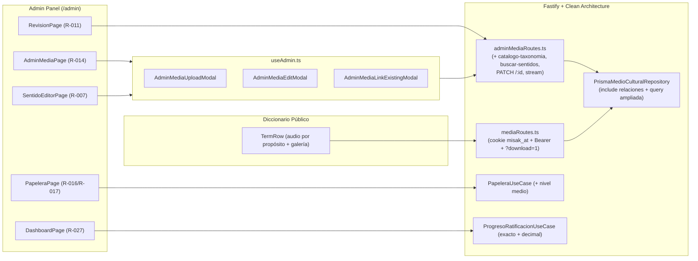

# Plan Técnico: 014 — Ecosistema Bidireccional de Medios Culturales

- **Feature**: `014-ecosistema-bidireccional-medios-culturales`
- **Estado**: Completado
- **Fecha**: 2026-11-13
- **Spec**: [`specs/features/014-ecosistema-bidireccional-medios-culturales/spec.md`](file:///home/tumidev/developments/misak-dictionary/specs/features/014-ecosistema-bidireccional-medios-culturales/spec.md)

---

## Arquitectura General

## Decisiones de Implementación

1. **Streaming autenticado sin exponer JWT en URL**:
   `AuthController` emite adicionalmente la cookie `HttpOnly` `misak_at` (acotada a `path: '/api/media'`, `SameSite: 'lax'`) al iniciar sesión y refrescar token, limpiándola en `logout`. `GET /api/media/:uuid/stream` verifica `Authorization: Bearer` o `cookies.misak_at`, consultando permisos vivos (`media:read` o `dictionary:read`) para habilitar `canReadDrafts: true` en `<audio>`, `` y `<video>` del panel editorial.
2. **Permisos de catálogo para `media_admin`**:
   En lugar de ampliar permisos globales del rol `media_admin` con `dictionary:read`, `adminMediaRoutes` agrega `GET /api/admin/medios/catalogo-taxonomia` y `GET /api/admin/medios/buscar-sentidos` protegidos por `media:read`.
3. **Progreso global exacto sin romper tests heredados**:
   `ProgresoRatificacionUseCase` conserva la respuesta de arreglo de nodos (`ProgresoNodoItem[]`) en `GET /api/admin/governance/progreso` mientras refina el cálculo de porcentajes (`0 < pct < 1` a 2 decimales y cálculo preciso en `useProgresoRatificacion` deduplicando por campos o leyendo totales exactos). Si se consulta desde `ProgresoRatificacionUseCase`, los nodos padre suman con precisión fraccional en `<1%` cuando hay sentidos ratificados.
4. **Modales accesibles siguiendo Modern Web Guidance**:
   Diálogos de desvinculación/envío a papelera, edición y vinculación reutilizan `AdminDialog` con botones explícitos de cierre, manejo de foco inicial/tecla Escape, labels asociados y `<audio controls>`/`<video controls>` accesibles en previsualización.
5. **Endurecimiento Operativo en Túneles y Móvil (Opción A — R-011..R-013)**:
   - **Opción A (Gobierno Público de Medios):** `CampoSemanticoRepository` y `PalabraRepository` mantienen `where: { deletedAt: null, estado: 'ratificado' }` en todos los `mediosInclude` públicos aunque `PUBLIC_ONLY_RATIFIED` sea `false`, impidiendo exponer URLs privadas (403) a visitantes no autenticados.
   - **Streaming RFC 9110:** `GetMediaStreamUseCase` y `LocalStorageService` soportan rangos sufijo `bytes=-N`, responden HTTP `416` (`RangeNotSatisfiableError` con `Content-Range: bytes */total`) y manejan `HEAD` sin lecturas innecesarias; el PWA Workbox restringe `cacheableResponse.statuses` a `[200]` y `AudioPlayerContext` serializa intentos con control de `AbortError` y transición de pausas.
   - **Cuotas Aisladas y Sin Reintento `4xx`:** `rateLimitPolicy.ts` separa buckets para diccionario público (`300/min`), admin por `userId` verificado (`600/min`) y streaming (`600/min`, `HEAD` exento); TanStack Query (`queryRetry.ts`) suprime reintentos en códigos `4xx`.
6. **Layout Responsivo del Visor Multimodal y Miniaturas (R-014 — extiende Spec 007 R-011):**
   - **Desacoplamiento `fit="contain"` en `LazyImage`:** `LazyImage` incorpora `fit?: 'cover' | 'contain'` (defecto `'cover'`) e `imgClassName`, aplicando `object-contain max-w-full max-h-full w-auto h-auto` directamente sobre `<motion.img>` sin romper cards/hero que dependen de `cover`.
   - **Panel Flex Viewport-Aware (`dvh` + Landscape Compacto):** `.misak-lightbox-*` en `index.css` y `CulturalMediaLightbox` usan `92vh`/`92dvh`, cabecera y pie `shrink-0`, escenario `flex-1 min-h-0 overflow-hidden`, limitación dual ancho/alto de imagen y video (`aspect-video`), compactación `@media (max-height: 500px)`, título `<h2>` no truncado y borde superior de metadatos condicional.
   - **Miniaturas Cuadradas `TermRow`:** botones `aspect-square w-14 h-14 sm:w-16 sm:h-16` con `fit="contain"`, overlay `aria-hidden="true" pointer-events-none` y captura de `mediaTriggerRef.current = e.currentTarget` en cada disparador visual.
7. **Sidebar Administrativo Responsivo con Scroll Independiente y Desbloqueo `inert` (R-015 — extiende Spec 006 R-021):**
   - **Altura Acotada y Scroll Independiente en `<nav>`:** `.misak-admin-scope` define `--admin-header-h: 4.3125rem` (`69px`) y `.misak-admin-sidebar` acota el `<aside>` de escritorio desde `@media (min-width: 64rem)` a `calc(100vh - var(--admin-header-h))` con mejora progresiva `@supports (height: 1dvh)` (`calc(100dvh - var(--admin-header-h))`). En `AdminLayout.tsx`, `<aside>` usa `hidden lg:flex lg:w-60 xl:w-64 shrink-0 flex-col lg:sticky lg:top-[var(--admin-header-h)] lg:self-start lg:overflow-hidden misak-admin-sidebar`, delegando el scroll vertical a `<nav>` (`flex-1 min-h-0 overflow-y-auto overscroll-contain p-4 space-y-1 misak-admin-sidebar-nav`) y fijando el pie `"Resguardo de Guambia"` con `shrink-0`.
   - **Sincronización `matchMedia('(min-width: 64rem)')` y Foco/Tap Targets:** Un `useEffect` escucha `window.matchMedia('(min-width: 64rem)')` mientras `drawerOpen` está activo para cerrarlo automáticamente al pasar a escritorio y evitar que `inert` bloquee el panel; el cierre del drawer por teclado (`Escape`), botón o backdrop restaura el foco a `menuTriggerRef`, y todos los enlaces y botones del drawer adoptan `min-h-[48px]` (Constitución `C3.2`).
