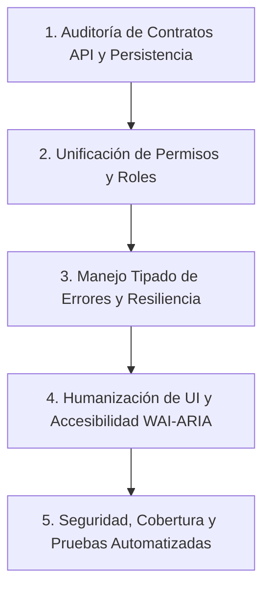

# Metodología y Checklist Replicable para Revisión y Optimización de Módulos

Este documento define la hoja de ruta técnica estándar para auditar, corregir y optimizar los módulos del sistema (Léxico y Sentidos, Medios Culturales, Cola de Revisión, Papelera, Auditoría, Ajustes del Sistema).

---

## 1. Protocolo de Auditoría y Ejecución en 5 Pasos

### Paso 1: Auditoría de Contratos API y Persistencia
- [ ] Verificar que las peticiones frontend usen los tipos e interfaces exactos del backend.
- [ ] Validar que los identificadores (`BigInt` / `string` / `uuid`) no se corrompan en serialización JSON.
- [ ] Asegurar que el estado persista correctamente tras recargas de página (F5) sin depender de estados efímeros o desincronizados.
- [ ] En operaciones mutantes destructivas, exigir confirmación modal explícita y revocación o borrado en cascada consistente.

### Paso 2: Unificación de Permisos y Roles
- [ ] Contrastar las rutas y componentes contra la matriz canónica (`shared/auth/permissions.ts`).
- [ ] Erradicar cadenas mágicas o desalineaciones léxicas entre frontend (`taxonomy:read`) y backend (`dictionary:read`).
- [ ] Comprobar que ningún rol quede en bloqueo ciego («Sin permiso para acceder a esta sección») al iniciar sesión o consultar sus módulos autorizados.
- [ ] Implementar un test de contrato automatizado que garantice sincronía permanente entre cliente y servidor.

### Paso 3: Manejo Tipado de Errores y Resiliencia
- [ ] Prohibir bloques `catch {}` genéricos que muestren mensajes engañosos o asuman fallos de credenciales ante caídas de servidor o límites de tasa.
- [ ] Mapear errores de base de datos (`P1001`, `P1002`) a HTTP 503 con mensaje empático de servicio no disponible.
- [ ] Mapear rate limits a HTTP 429 con cabecera `Retry-After` y temporizador regresivo visible en interfaz.
- [ ] Asegurar que los errores de validación (Zod) resalten el campo específico en el formulario.

### Paso 4: Humanización de UI y Accesibilidad WAI-ARIA
- [ ] Eliminar tecnicismos, siglas en inglés (`RBAC`) y jerga de base de datos (`super_admin`, «en crudo», «expedientes normalizados»).
- [ ] Centralizar el copy del módulo en un archivo dedicado `*Copy.ts` con lenguaje claro y accesible para usuarios no técnicos.
- [ ] Formatear todos los textos de ejemplo con prefijo uniforme (`Ej. ...`).
- [ ] Eliminar barras de desplazamiento internas anidadas (doble scroll) en contenedores de pocas opciones.
- [ ] Asegurar atributos ARIA obligatorios: `role="dialog"`, `aria-modal="true"`, foco atrapado en modales y restauración de foco al cerrar.
- [ ] Mantener soporte bimodal impecable (Light/Dark) con la paleta de 4 colores Misak (`#E52D6D`, `#0055AA`, `#FFFFFF`, `#000000`).

### Paso 5: Seguridad, Cobertura y Pruebas Automatizadas
- [ ] Verificar que no existan vulnerabilidades de escalada horizontal o vertical de privilegios.
- [ ] Validar que datos sensibles (tokens, contraseñas temporales) no queden en logs ni persistencias inseguras (`localStorage`).
- [ ] Implementar tests unitarios e integrados que cubran el camino feliz y los casos de borde (edge cases).
- [ ] Superar el umbral estricto de cobertura global ($\ge 70\%$ en líneas, ramas, funciones y declaraciones).
- [ ] Ejecutar validación de tipos (`tsc -b`) y linter (`biome ci .`) sin errores ni advertencias.

---

## 2. Matriz de Aplicabilidad por Módulo

| Módulo | Enfoque Crítico de Revisión |
| :--- | :--- |
| **Gobernanza de Usuarios y Sesión (Ref. 008)** | Errores de login, persistencia en F5, suspensión segura, clave temporal, roles en español. |
| **Léxico y Sentidos** | Formas dialécticas, paginación con cursor, normalización de glosa y lema, filtros responsivos. |
| **Medios Culturales** | Subida streaming hasta 100 MB, ratificación comunitaria, metadatos culturales y licencias. |
| **Cola de Revisión** | Checklist de ratificación, reversión con motivo histórico, alertas bilingües. |
| **Papelera de Reciclaje** | Confirmación por código léxico, purga irreversible, auto-detección de jerarquía. |
| **Auditoría del Sistema** | Trazabilidad por actor y entidad, paginación, filtros por fecha y acción. |
| **Ajustes del Sistema** | Selector centralizado de tema light/dark, políticas globales y switches con feedback inmediato. |
